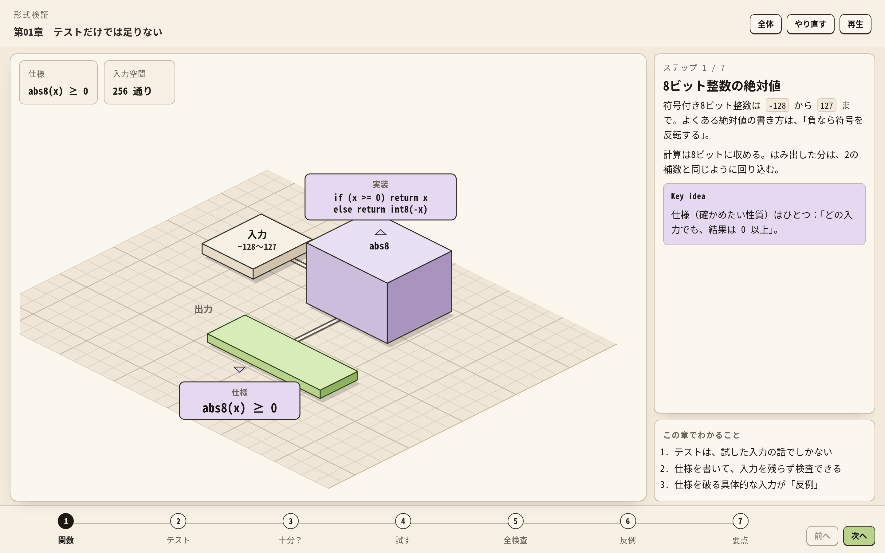
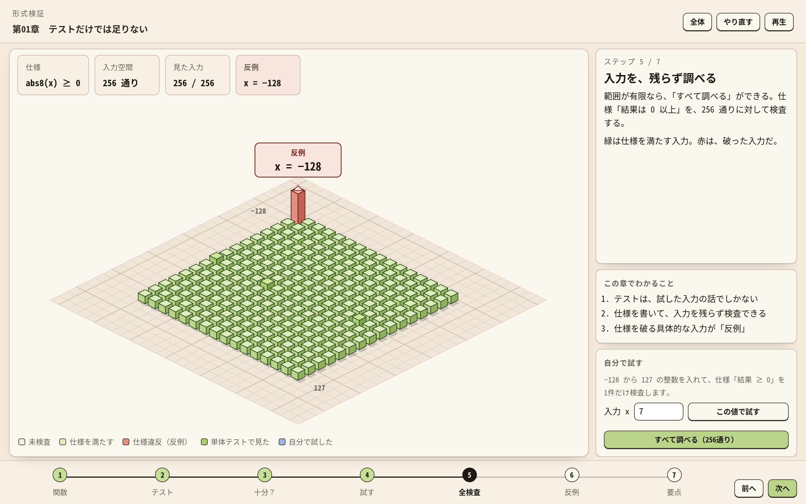
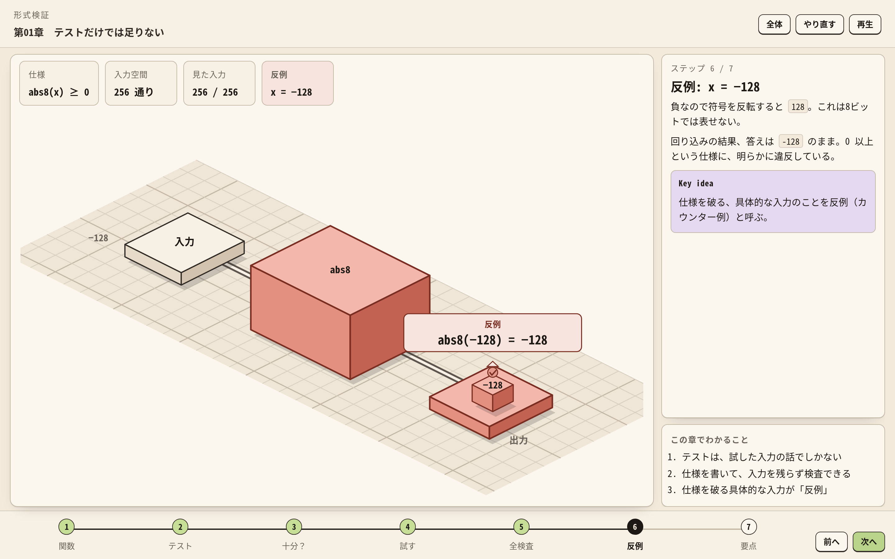

# 形式検証 — 第1章「テストだけでは足りない」

符号付き8ビット整数の絶対値 `abs8` には、`x = -128` で符号反転が `128` になり、8ビットの回り込みで結果が `-128` のまま残るバグがあります。正・負・ゼロのユニットテスト3本はすべて成功しますが、256通りの入力を残らず調べる全数検査が、仕様「結果は 0 以上」を破る反例を見つけます。画面はアイソメトリックな SVG のステップ送りで、[designed-to-scale.vercel.app](https://designed-to-scale.vercel.app) の見せ方に着想を得ており、コードはコピーしていません。

ツールチェーンは [Vite+](https://viteplus.dev/)（グローバル CLI は `vp`）です。Vite、Rolldown、Oxlint、Oxfmt、型チェックをひとつのコマンド群で扱います。macOS / Linux で `vp` がまだ無いときは、次で入れます。

```bash
curl -fsSL https://vite.plus | bash
```

インストール後は新しいシェルを開くか、表示された `env` ファイルを読み込んでください。

## 画面

ステップ 1。関数・仕様・入力空間（−128〜127 の 256 通り）。



ステップ 5。256 通りを残らず調べ、赤い柱が反例 `x = −128`。



ステップ 6。`abs8(−128) = −128` になるまでの追跡。



## 動かし方

```bash
cd formal-verification
vp install
vp dev          # http://127.0.0.1:5173
```

チェック、ビルド、プレビュー:

```bash
vp check        # フォーマット・lint・型チェック
vp build
vp preview      # http://127.0.0.1:4173
```

依存関係の追加・削除は `vp add` / `vp remove` を使います。型チェックは `vp check` に含まれます。`tsc --noEmit` だけ走らせたいときは `vp exec tsc --noEmit` です。

## 操作

- 矢印キーでステップを進める・戻る
- Space で再生 / 一時停止
- R でそのステップをやり直す
- 0 で全体表示
- ドラッグで移動、ホイールで拡大・縮小
- URL は `#/ch1/1` から `#/ch1/7`
