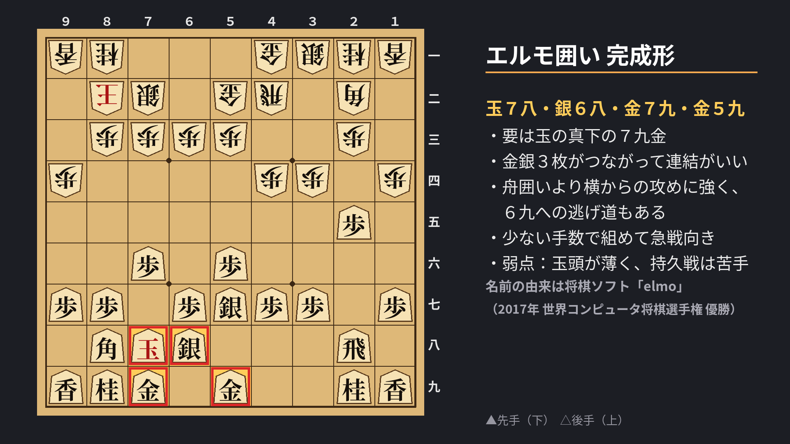

# エルモ囲い

日付: 2026-11-22

四間飛車を相手にした定番の組み方。完成形と、そこに至る 21 手を残す。

## 完成形（先手）

| 駒 | 位置 |
|---|---|
| 玉 | 7八 |
| 銀 | 6八 |
| 金 | 7九 |
| 金 | 5九 |

要になるのは、玉の真下にある 7九の金。

5七の銀は囲いの一部ではなく、攻めに使う駒。

## 手順（21手）

対四間飛車の例。

1. ▲7六歩
2. △3四歩
3. ▲2六歩
4. △4四歩
5. ▲2五歩
6. △4二飛
7. ▲6八玉
8. △6二玉
9. ▲7八玉
10. △7二玉
11. ▲6八銀
12. △8二玉
13. ▲7九金
14. △7二銀
15. ▲5九金
16. △5二金左
17. ▲5六歩
18. △9四歩
19. ▲4八銀
20. △1四歩
21. ▲5七銀右

この手順は [shogigame.org の解説](https://shogigame.org/learn/castles/elmo) を参考にした。完成形は [Wikipedia の図](https://ja.wikipedia.org/wiki/エルモ囲い) と一致することを確認している。

## 特徴

- 舟囲いより、横からの攻めに強い
- 少ない手数で組める
- 玉の頭が薄いので、長い戦い（持久戦）は苦手
- 名前は、2017年の世界コンピュータ将棋選手権で優勝した将棋ソフト「elmo」から

## 動画

[elmo.mp4](elmo.mp4)（約 43 秒、音なし）。上の 21 手を 1 手ずつ動かして、最後に完成形を出す。生成スクリプトは [make.py](make.py)。Pillow・ffmpeg・Noto CJK フォントを入れて `python3 make.py` を実行すると、このフォルダに `elmo.mp4` と `final.png` を作り直す。

## 参考

- [エルモ囲い - Wikipedia](https://ja.wikipedia.org/wiki/エルモ囲い)
- [Elmo Castle - shogigame.org](https://shogigame.org/learn/castles/elmo)
- [エルモ囲い - Shogi Castle](https://shogicastle.com/ja/kakoi/elmo-gakoi/)
- [エルモ囲い - shougi.jp](https://shougi.jp/kakoi/elmo/)
- [エルモ囲い - 将棋ジム](https://shogi-gym.com/kakoi/elmo/)
